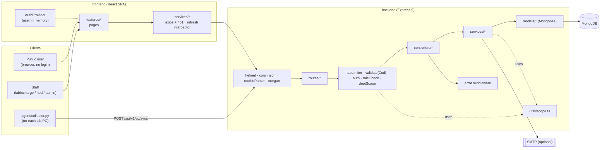
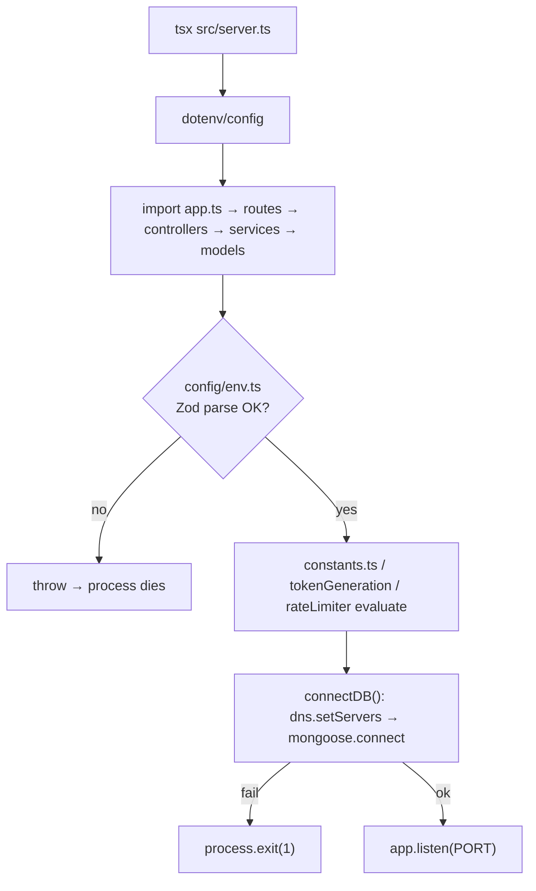
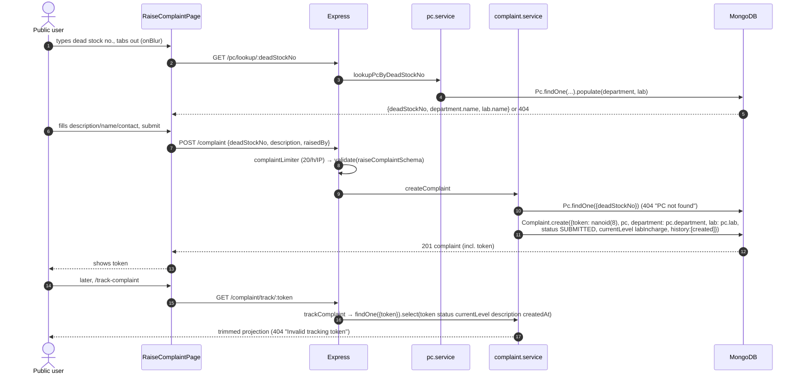
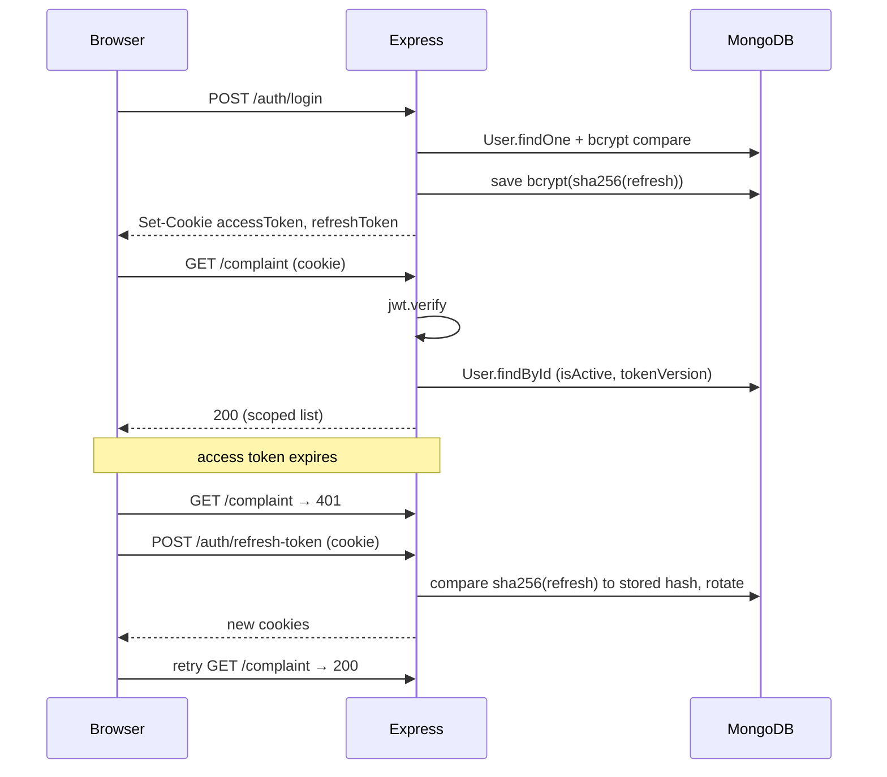
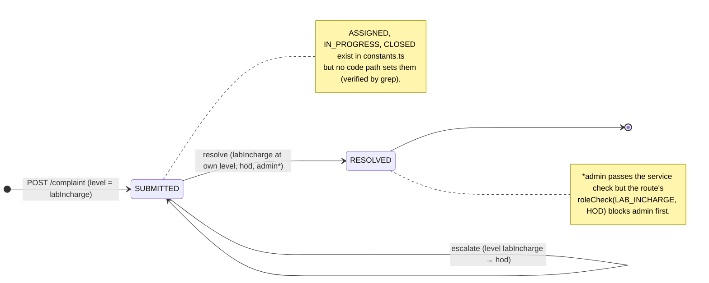
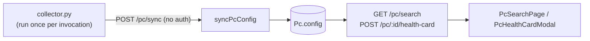
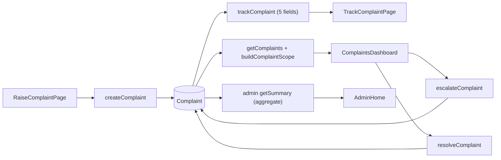

# LABMON — Project Architecture & Codebase Report

> Generated 2026-10-23 from a read-through of the working tree on branch `person-1` (git status was clean at the start).
> **Method:** I read every backend source file under `backend/src` (except test bodies and three seed scripts, which I only skimmed), the Python agent, the frontend routing/auth/service layers and the main feature pages, plus CI and config. I did **not** run the server, the tests, or the agent, so statements like "works" mean "the code is written to do X", not "I observed X".
> **No secrets are included.** `.env.example` was read with values redacted.
> **Existing docs are partly stale** — see §17 (F-1). Where `CLAUDE.md`, `backend/docs/*` and the code disagree, this report follows the code.

---

## 1. Executive summary

LABMON is a **lab PC health monitoring + complaint management** system for a college. It has three independent runtimes that share no code:

| Runtime | What it is | Talks to |
|---|---|---|
| `agent/` | Python script run on each lab PC; collects CPU/RAM/disk/OS/installed-software and POSTs it | Backend `POST /api/v1/pc/sync` |
| `backend/` | Express 5 + Mongoose 9 REST API, strict TypeScript | MongoDB, SMTP (optional) |
| `frontend/` | React 19 + Vite SPA, strict TypeScript | Backend REST API |

Three kinds of people use it:

1. **Anyone, no login** — looks up a PC by dead-stock number, raises a complaint, gets an 8-char tracking token, later checks status by token.
2. **Staff (login)** — `labIncharge` and `hod` work the complaint queue and search PC health cards; `admin` provisions HODs and sees a summary.
3. **The PC itself** — the agent pushes its hardware config (unauthenticated, rate-limited).

**There are no AI agents, LLM calls, queues, background jobs or workers in this repository.** The only "agent" is the Python collector, and it is an ordinary script (§8). The only event-like mechanism is a tiny in-process `EventEmitter` in `mailer.ts` used so tests can read OTPs without a mailbox.

**Overall impression:** the backend is small (≈5.4k lines including 1.6k of tests), cleanly layered, and consistently validated. Its best design choices are (a) the `auth` middleware re-reading the user from the DB every request so deactivation/logout take effect immediately, and (b) one file (`utils/scope.ts`) owning the "who can see what" rule. Its weak spots are the unauthenticated `/pc/sync` endpoint, inconsistent scoping between complaints (lab-level) and PCs (department-level), several status values that are defined but never used, and documentation that has drifted behind the code.

---

## 2. Project purpose and technology stack

### 2.1 Purpose
Keep a **digital health card** per lab PC (hardware, software, warranty, department, lab, dead-stock number) and give the public a **login-free complaint channel** with an escalation chain **Lab Incharge → HOD**. Admin sits outside the chain and only monitors/provisions. (The older `deanInfra` role no longer exists in the code — `CLAUDE.md` still describes it.)

### 2.2 Stack (verified from `package.json`, `tsconfig.json`, imports)

| Concern | Choice | Why it is used here (from the code) |
|---|---|---|
| Language | TypeScript, `strict` + `noUncheckedIndexedAccess` + `exactOptionalPropertyTypes` (`backend/tsconfig.json`) | Catches shape drift between layers; frontend also strict (`tsc -b`) |
| Module system | ESM, `NodeNext`; imports use `.js` suffixes | Required by NodeNext; `tsx` runs TS directly in dev |
| HTTP | Express **5** | `asyncHandler` still used for explicit error forwarding; `validate.middleware.ts` has a comment about Express 5's read-only `req.query` |
| DB | MongoDB via Mongoose **9** | Embedded `config`/`warranty` sub-documents on `Pc`; refs between collections |
| Validation | Zod (request bodies/params in `validators/`, and env in `config/env.ts`) | Fail-fast at boot for env; 400 with field list at request time |
| Auth | `jsonwebtoken` (access + refresh), `bcrypt`, `cookie-parser` | httpOnly cookies + `Bearer` header fallback |
| Hardening | `helmet`, `cors` (single origin, credentials), `express-rate-limit`, `morgan` | |
| Mail | `nodemailer` (optional; logs to console when `SMTP_HOST` unset) | OTP + staff-credentials emails |
| IDs | `nanoid(8)` | Public complaint tracking token |
| Tests | Node's built-in `node --test` + `tsx` + `mongodb-memory-server` | Hermetic: `_setup.ts` starts an in-memory Mongo unless `MONGO_URL` is already in the real environment |
| Frontend | React 19, react-router-dom 7, axios, Vite 8, oxlint | No state library (`src/store/` is just `.gitkeep`); plain `useState` + one `AuthContext` |
| Agent | Python, `psutil`, `requests`, `winreg` (Windows only) | Cross-platform CPU/RAM/disk/OS; software list is Windows-only |
| CI | GitHub Actions `.github/workflows/ci.yml` | backend: `typecheck`, `build`, `test` against a `mongo:7` service; frontend: `lint`, `build` |

---

## 3. Repository structure and file responsibilities

```
labmon/
├─ agent/
│  ├─ collector.py          # the whole agent: collect → build payload → POST
│  ├─ config.json           # persisted dead_stock_no + backend_url (written by the agent)
│  ├─ run_agent.bat         # Windows launcher: picks venv python, pip-installs deps, runs collector.py
│  ├─ measure_payload.py    # dev helper: payload size / gzip savings
│  └─ requirements.txt      # psutil, requests
├─ backend/
│  ├─ src/
│  │  ├─ server.ts          # boot: connectDB → app.listen
│  │  ├─ app.ts             # Express app: middleware stack + router mounting
│  │  ├─ config/            # env.ts (Zod env), constants.ts (ROLES, statuses, OTP), departments.ts, db.config.ts
│  │  ├─ routes/            # auth, pc, complaint, dept, admin, hod  (wiring only)
│  │  ├─ controllers/       # thin: call a service, wrap in ApiResponse
│  │  ├─ services/          # business logic (auth, complaint, pc, admin, hod, dept)
│  │  ├─ models/            # Mongoose: user, department, lab, pc, complaint
│  │  ├─ middlewares/       # auth, roleCheck, deptScope, validate, rateLimiter, error
│  │  ├─ validators/        # Zod schemas per feature
│  │  ├─ utils/             # scope.ts, tokenGeneration.ts, otp.ts, mailer.ts, ApiError/ApiResponse, asyncHandler, requireAuth
│  │  ├─ types/             # auth.ts, express.d.ts (req.user, req.scope), mongo.ts
│  │  ├─ scripts/           # seed / seedAdmin / seedDepartments / seedLabs / migrate* (see §15 note on git-ignore)
│  │  └─ tests/             # 6 suites, 74 test cases (counted with grep), _setup.ts, helpers.ts
│  ├─ docs/                 # older per-module docs (partly stale)
│  └─ package.json, tsconfig*.json, .env.example
├─ frontend/
│  └─ src/
│     ├─ main.tsx, app/App.tsx, app/routes.tsx, app/providers/AuthProvider.tsx
│     ├─ services/          # axios wrappers: apiClient, auth, complaint, pc, dept, admin, hod
│     ├─ features/          # auth, public-complaint, complaints (shared dashboard), hod, lab-incharge, admin, pc-search, laboratories, + 3 stubs
│     ├─ components/common/ # ProtectedRoute, DetailModal
│     ├─ constants/, types/, hooks/useAuth.ts, utils/formatDate.ts
├─ docs/                    # root-level project docs (API_CONTRACT, ARCHITECTURE, DATABASE, ROLES_AND_PERMISSIONS, …)
├─ prd.md, about-project.md, CLAUDE.md
└─ .github/workflows/ci.yml
```

**Layering rule (verified):** `routes → [middlewares] → controllers → services → models`. Controllers never touch models; services never touch `req`/`res`. The only exception worth noting is `middlewares/auth.middleware.ts`, which imports the `User` model directly (deliberate — see §7.3).

---

## 4. System architecture



**Communication kinds in this codebase (they are all the plain kind):**

| Kind | Where |
|---|---|
| Direct function call | route → controller → service → model; `scope.ts` helpers |
| HTTP/REST | frontend ↔ backend; agent → backend |
| Shared state | MongoDB only; frontend `AuthContext` (in-memory); `req.user` / `req.scope` set by middleware and read downstream |
| Event-driven | **Only** `otpEvents` `EventEmitter` in `utils/mailer.ts` (in-process; emits `"otp"`/`"credentials"` before sending; only tests listen) |
| Queues / jobs / cron / agent-to-agent orchestration | **None exist** |

---

## 5. Application startup and initialization

### 5.1 Backend (`npm run dev` → `tsx watch src/server.ts`)

1. `server.ts` — `import "dotenv/config"` loads `.env` into `process.env`.
2. `server.ts` imports `./app.js`, which imports routers → controllers → services → models and `config/env.ts`.
3. **`config/env.ts` runs at import time**: Zod `safeParse(process.env)`. Required: `MONGO_URL`, `JWT_ACCESS_TOKEN`, `JWT_ACCESS_EXPIRY`, `JWT_REFRESH_TOKEN`, `JWT_REFRESH_EXPIRY`. On failure it **throws** `Invalid environment configuration: …`, so the process dies before listening. Defaults: `PORT=8000`, `CORS_ORIGIN`/`FRONTEND_URL=http://localhost:5173`.
4. `config/constants.ts` derives `OTP_MAX_ATTEMPTS` (default 5) and `OTP_RESEND_COOLDOWN_SECONDS` (default 60) from `env` at import time.
5. `controllers/auth.controller.ts` computes `ACCESS_TOKEN_MAX_AGE` / `REFRESH_TOKEN_MAX_AGE` via `parseExpiryToMs(env.JWT_*_EXPIRY)` at import — a malformed expiry like `"15 minutes"` throws here (regex `^(\d+)(s|m|h|d)$`).
6. `rateLimiter.ts` builds the five limiters at import (reading `env.RATE_LIMIT_*`).
7. `app.ts` builds the Express app (order matters): `helmet()` → `cors({origin, credentials:true})` → `express.json({limit:"10mb"})` → `urlencoded` → `cookieParser()` → `morgan("dev")` → six routers under `/api/v1/{auth,pc,complaint,dept,admin,hod}` → `errorHandler` last.
8. `server.ts` calls `connectDB()`: forces DNS to `8.8.8.8`/`1.1.1.1` (workaround for SRV lookups with `mongodb+srv://`), then `mongoose.connect(env.MONGO_URL)`. On failure inside `connectDB` it logs and calls **`process.exit(1)`**.
9. On success, `app.listen(PORT)`.



**Note:** no seed runs on boot. Departments are lazily ensured the first time `GET /dept` (or `createHod`) runs; the first Admin must be created with `npm run seed:admin` (reads `ADMIN_EMAIL`/`ADMIN_PASSWORD`/`ADMIN_NAME`).

### 5.2 Frontend
`main.tsx` → `<StrictMode><App/>` → `BrowserRouter` → `AuthProvider` → `AppRoutes`. `AuthProvider`'s `useEffect` calls `GET /auth/me` once; success sets `user`, failure sets `user=null`; `loading` stays `true` until it settles, and `ProtectedRoute` renders `null` while loading (no flash-redirect).

### 5.3 Agent
`python collector.py` (or `run_agent.bat`). At import it reads `config.json` for `backend_url` / `dead_stock_no`; `LABMON_BACKEND_URL` env overrides. Default URL is `http://localhost:8000` (this now **matches** the backend's default `PORT=8000`; `CLAUDE.md`'s warning about port 5000 is outdated).

---

## 6. Complete execution flow (the main workflows)

### 6.1 Workflow A — PC health-card sync (agent → DB)

**Trigger:** someone runs `run_agent.bat` / `python collector.py` on a lab PC.

1. `collector.main()` parses `--dead-stock`, `--department`, `--lab`, `--dry-run`.
2. Dead-stock number: CLI flag → `config.json` → interactive `input()`. Persisted back to `config.json` (so the next run is silent).
3. Department: if `config.json` already had a dead stock number and no `--department` flag, it sends `""` (treated as "already provisioned"); otherwise it prompts.
4. `build_payload()` calls `collect_cpu/ram/disk/os/software`:
   - CPU: Windows registry `ProcessorNameString` + logical core count; else `platform.processor()`+freq.
   - RAM/disk: `psutil` totals in GB (disk = `C:\` on Windows, else `/`).
   - Software (Windows only, `winreg`): scans three `Uninstall` registry keys, drops "noise" names, keeps only names matching an **allowlist** (default: Microsoft Office family; override with `LABMON_SOFTWARE_ALLOWLIST`, `all`/`*` disables filtering), normalises casing/locale suffix, returns a sorted set.
   - Adds `lastSyncedAt` (UTC ISO).
5. `sync()` → `requests.post(SYNC_ENDPOINT, json=payload, timeout=30)`; `raise_for_status()`. Any `RequestException` → prints `Sync failed` and `sys.exit(1)`. **No retry, no queue, no offline buffer.**
6. Backend: `POST /api/v1/pc/sync` → `pcSyncLimiter` (30/min/IP) → `validate(syncPcSchema)` (`deadStockNo` required; `department`, `lab`, `config` optional; `config` is `record<string, any>`) → `syncPc` controller → `syncPcConfig()` (`pc.service.ts:50`):
   - Flattens `config` into `$set` keys `config.<key>`; always sets `config.lastSyncedAt = new Date()` (server time — the agent's own timestamp is overwritten).
   - **Branch 1 – PC exists:** optionally re-resolve `department` (by exact name, 404 if unknown) and `lab` (find-or-create via `findOneAndUpdate … upsert`), then `findOneAndUpdate`. Returns updated doc.
   - **Branch 2 – PC absent and no `department`:** `404 "PC not found. Check dead stock number."`
   - **Branch 3 – PC absent, `department` given:** resolve department, optionally upsert lab, `Pc.create` with `warranty:{status:"Active"}`.
7. Response: `ApiResponse(200, pc, "PC config updated")`.

**Failure behavior:** validation → 400 with `errors[{field,message}]`; unknown department → 404; rate limit → 429 JSON; anything else → 500 via `errorHandler`. Agent just prints and exits 1.

### 6.2 Workflow B — public complaint, end to end



Key design points: the complaint **copies** `department` and `lab` from the PC at creation (so later PC moves don't re-route old complaints), and the public `track` endpoint returns only five fields (no `raisedBy.contact`, no history).

### 6.3 Workflow C — staff login / session lifecycle

1. `AuthPage` → `authService.login` → `POST /auth/login` → `loginLimiter` (10/15 min/IP) → `validate(loginSchema)` → `login` controller → `loginUser()` (`auth.service.ts:222`):
   - find by email → `comparePassword` (bcrypt) → 401 `"Invalid email or password"` for both unknown email and bad password (no user enumeration here)
   - `isActive` false → 403; `isEmailVerified` false → 403
   - `generateAccessToken(user)` (claims `id, role, department, tokenVersion`) and `generateRefreshToken(user)` (claim `userId`)
   - stores `bcrypt(sha256(refreshToken))` in `user.refreshToken` (SHA-256 first because bcrypt truncates at 72 bytes — explained in a code comment)
   - populates `department.name`, `lab.name`
2. Controller sets two cookies `accessToken` / `refreshToken` (`httpOnly`, `sameSite:"strict"`, `secure` only in production, `maxAge` from the expiry env).
3. Frontend stores `user` in `AuthContext` and navigates by role (`HOME_ROUTE_BY_ROLE`).
4. **Every protected request:** `auth` middleware (`auth.middleware.ts:14`):
   - token from `Authorization: Bearer …` **or** `accessToken` cookie
   - `jwt.verify` → 401 on failure
   - **re-reads the user** (`select role department lab isActive tokenVersion`): missing → 401; `!isActive` → 403; `tokenVersion` mismatch → 401 `"Session expired"`
   - sets `req.user = {id, role, department, lab, tokenVersion}` **from the DB, not from the token claims**
5. **Expiry:** axios response interceptor (`apiClient.ts`) catches a 401 (excluding the auth endpoints), calls `POST /auth/refresh-token` once (de-duplicated through a shared `refreshPromise`), then retries the original request with `_retried=true`.
6. `refreshAccessToken()` verifies the refresh JWT, loads the user, compares `sha256(token)` against the stored bcrypt hash, then **rotates** (issues and stores a new pair).
7. `logoutUser()` clears `refreshToken` and **increments `tokenVersion`**, which invalidates every outstanding access token for that user at the next `auth` check.



### 6.4 Workflow D — escalate and resolve

**Escalate:** `PATCH /complaint/:id/escalate` → `auth` → `roleCheck(LAB_INCHARGE, HOD)` → `validate(objectIdParamSchema,"params")` → `escalateComplaint()` (`complaint.service.ts:61`). Checks in order:
1. complaint exists (404)
2. status not `RESOLVED`/`CLOSED` (400)
3. `assertLabAccess` — same department, and same lab for a lab-assigned incharge (403)
4. `user.role === complaint.currentLevel` (403 "Only the current level's incharge…")
5. `NEXT_LEVEL[currentLevel]` exists (400 "already at the highest level" — i.e. HOD)

Then `currentLevel = hod`, appends `{level, action:"escalated", by, at}` to `history`, saves, populates `lab`, `department`, `history.by`. **`status` is deliberately untouched.**

**Resolve:** `PATCH /complaint/:id/resolve` (same guards + body `remarks?`) → `resolveComplaint()` (`:114`): 404 → terminal-status 400 → `assertLabAccess` → role check (must be current level, or HOD, or ADMIN) → `status = RESOLVED`, history entry with optional `note`. HOD can therefore resolve a complaint still sitting at the lab incharge level.

**List:** `GET /complaint` → `getComplaints()` (`:180`) → `buildComplaintScope(user)` → `Complaint.find(scope).sort(createdAt:-1).populate(...)`.



### 6.5 Workflow E — staff provisioning (two parallel paths)

| Path | Route | Who | Behavior |
|---|---|---|---|
| **Admin → HOD** | `POST /admin/staff` | admin | `createHod` (`admin.service.ts:71`): rejects if email is admin/HOD, **deletes** an existing user of another role with that email, resolves department by ObjectId → name → fallback to the static `DEPARTMENTS` list (upsert), emails credentials, saves user with `isEmailVerified:true` |
| **HOD → Lab Incharge** | `POST /hod/staff` | hod | `createLabIncharge` (`hod.service.ts:13`): department is forced to the HOD's own; same email/delete logic; emails plaintext credentials; `lab: null` |
| **Generic register + OTP** | `POST /auth/register` → `POST /auth/verify-email` (+ `/resend-otp`) | admin (route is `auth + roleCheck(ADMIN)`) | `registerUser` accepts `role ∈ {hod, labIncharge}`, `department` name, optional `lab` name; sends a 6-digit OTP (hashed with bcrypt; 10-min expiry; attempt lockout) |

The frontend only has UI for the first two (`StaffManagementPage`, `LabInchargeManagementPage`); `authService.register` exists but I found no page calling it. **Only `/auth/register` can assign a `lab`** to a labIncharge — the HOD flow always sets `lab: null`.

---

## 7. Module-by-module analysis

### 7.1 `config/`
| File | Purpose | Notes |
|---|---|---|
| `env.ts` | Zod-validated `env` object, `isTestEnv`, `isProduction` | Every module imports `env`, not `process.env` |
| `constants.ts` | `ROLES`, `COMPLAINT_STATUS`, `TERMINAL_STATUSES`, `NEXT_LEVEL`, `OTP_PURPOSE`, OTP limits | Single source of truth; the frontend mirrors it by hand in `constants/roles.ts` |
| `departments.ts` | Master list `IT`, `CS` | Add an entry to add a department (ensured lazily by `dept.service.ts`) |
| `db.config.ts` | `connectDB()` | DNS override + `process.exit(1)` on failure |

### 7.2 `models/`
| Model | Key fields | Relations / indexes |
|---|---|---|
| `User` | `name, email(unique,lowercase), password, role, department, lab, isActive, tokenVersion, refreshToken, isEmailVerified, otp*, otpAttempts, lastOtpSentAt` | `otp*` fields are `select:false`; `pre("save")` bcrypt-hashes `password` when modified; `comparePassword()` method |
| `Dept` | `name(unique), code(uppercase)` | |
| `Lab` | `name, labNumber?, department, incharge?` | unique index `(department, name)` |
| `Pc` | `deadStockNo(unique), department, lab?, warranty{status,expiryDate}, purchaseDate, config{cpu,ram,disk,os,software[],lastSyncedAt}` | indexes `(department, lab)`, `warranty.status` |
| `Complaint` | `token(unique), pc, department, lab?, description, raisedBy{name,contact}, status, currentLevel, history[{level,action,by,at,note}]` | |

`Lab.incharge` is declared but I found no code that reads or writes it (the user→lab link lives on `User.lab`).

### 7.3 `middlewares/`
| Middleware | Input | Output / effect | Failure |
|---|---|---|---|
| `auth` | cookie/Bearer token | `req.user` from DB | 401/403 `ApiError` via `next(err)` |
| `roleCheck(...roles)` | `req.user` | pass or 403 | `throw ApiError(403)` (sync, Express 5 catches) |
| `deptScope` | `req.user` | `req.scope = buildDepartmentScope(user)` | 401 if no user |
| `validate(schema, target)` | `req[target]` | replaces `req[target]` with Zod-parsed (trimmed/lowercased) data | 400 `Validation failed` + `errors[]` |
| `rateLimiter` | IP | 429 JSON; **skipped when `NODE_ENV=test`** | |
| `errorHandler` | any error | `ApiError` → its status; anything else → logged, generic 500 | |

### 7.4 `utils/scope.ts` — the access-control core
| Function (line) | Rule |
|---|---|
| `buildDepartmentScope` (16) | admin → `{}`; everyone else → `{department}` |
| `assertDepartmentAccess` (23) | 403 unless admin or same department. **Defined but never called anywhere in `backend/src` (grep-verified)** |
| `buildLabScope` (32) | admin `{}`; lab-assigned incharge `{department, lab}`; else `{department}`. **Also never called (grep-verified)** |
| `assertLabAccess` (44) | admin ok; department must match; lab-assigned incharge must match lab. Used by escalate/resolve |
| `buildComplaintScope` (64) | admin `{}`; hod `{department}`; incharge `{department, lab}` if lab assigned else `{department}`. Used by `getComplaints` |


### 7.5 Services (see §9 for function-level detail)
`auth.service` (registration/OTP/login/refresh/logout/me), `complaint.service` (create/escalate/resolve/track/list), `pc.service` (sync/health card/lookup/search), `admin.service` (summary + HOD CRUD), `hod.service` (Lab Incharge CRUD within the HOD's department), `dept.service` (ensure + list departments).

### 7.6 `utils/mailer.ts`
`getTransporter()` is lazily created and cached; **returns `null` when `SMTP_HOST` is unset or `NODE_ENV=test`**, in which case emails are only `console.log`ged. `sendOtpEmail` and `sendCredentialsEmail` both emit an `otpEvents` event first (tests subscribe). `sendCredentialsEmail` swallows SMTP errors (logs and continues, account still created).

### 7.7 Frontend modules
| Module | Responsibility |
|---|---|
| `app/routes.tsx` | Route table; public pages; `ProtectedRoute allowedRoles=[…]` per dashboard; legacy redirects (`/dean-infra` → admin dashboard) |
| `services/apiClient.ts` | axios instance (`withCredentials`), request interceptor adds `Authorization` from `localStorage.accessToken` **if present**, response interceptor does the single-flight refresh+retry |
| `features/complaints/ComplaintsDashboard.tsx` | Shared dashboard used by both `LabInchargeHome` and `HodHome`; fetches `GET /complaint`; stats, filters, escalate/resolve with optimistic row replacement |
| `features/hod/*` | `HodHome` toggles between Lab Incharge management and the complaints dashboard (local `useState`, not routes) |
| `features/admin/*` | `AdminHome` + `StaffManagementPage` (HOD CRUD, summary) |
| `features/pc-search/*` | `PcSearchPage` + `PcHealthCardModal`; `LaboratoriesPage` is a one-line wrapper |
| `features/equipment`, `inventory`, `requests` | **Stub placeholders** (≈9 lines each) |

---

## 8. Agent-by-agent analysis

**There are no AI agents, orchestrators, tools, prompts, models, memory stores or agent-to-agent messaging anywhere in this repo** (I searched for LLM/Anthropic/OpenAI usage in the files I read and found none; `package.json`/`requirements.txt` list no AI SDK). Everything below concerns the one component named "agent" in the project: the Python collector.

### `agent/collector.py` — a script, not an autonomous agent
| Question | Answer (verified) |
|---|---|
| Why it exists | Gets real hardware/software data into `Pc.config` without manual entry |
| Initialization | Module import reads `config.json` and env; `argparse` in `main()` |
| Decision-making | None — a fixed pipeline with a few `if`s (flags vs saved config vs prompt) |
| "Tools" | OS APIs (`psutil`, `platform`, `winreg`) |
| Communication | One HTTPS-capable POST per run; no inbound channel, the backend cannot command it |
| State | Only `config.json` (`dead_stock_no`, `backend_url`) |
| Scheduling | **None built in** — it runs once and exits. Periodic runs would need Task Scheduler/cron configured outside the repo (I found no such config) |
| Auth to backend | **None** — no key/token/header is sent |
| Errors | Network/HTTP error → message + `exit(1)`; registry errors per key are swallowed (`except OSError: continue`) |
| Timeout | 30 s on the POST; no retries |

**Agent vs tool vs function vs orchestrator here:** `collector.py` is a *client script*; its `collect_*` are plain functions; there is no orchestrator. The server side of the same interaction is the ordinary `syncPcConfig` service function.

---

## 9. Function-level reference

Line numbers are within the named file.

### 9.1 Authentication & sessions

| Function | File:line | Responsibility / processing | Inputs → Output | Dependencies | Callers | Errors |
|---|---|---|---|---|---|---|
| `auth` | `middlewares/auth.middleware.ts:14` | Verify JWT, reload user, enforce active + tokenVersion, set `req.user` | req → `next()` | `jwt`, `User`, `env` | every protected route | 401 no/invalid token; 403 deactivated; 401 version mismatch |
| `roleCheck` | `middlewares/roleCheck.middleware.ts` | Factory; allow-list of roles | roles → handler | `ApiError` | all role-gated routes | 403 |
| `registerUser` | `services/auth.service.ts:82` | Dedup email, resolve dept/lab names to ids, create user, send OTP | `RegisterInput` → user (password unset) | `User, Dept, Lab, issueOtp` | `register` controller | 409 duplicate; 404 dept/lab; 400 lab without dept |
| `issueOtp` | `:69` | `crypto.randomInt` 6 digits → bcrypt hash → store with expiry, reset attempts, `lastOtpSentAt` → email plaintext | user, purpose | `generateOtp, hashOtp, sendOtpEmail` | register, resend | email errors propagate (500) |
| `verifyEmailOtp` | `:146` | Checks verified/pending/expiry/attempt-limit, compares OTP, on success marks verified and clears OTP fields; on failure `otpAttempts++` | email, otp | `compareOtp` | `verifyEmail` controller | 404/400/429 (lockout skipped in test env) |
| `resendOtp` | `:190` | Validates purpose, cooldown (60 s), re-issues | email, purpose | `isOtpPurpose, issueOtp` | `resend` controller | 400/404/429 |
| `loginUser` | `:222` | Password check, active+verified gates, mint tokens, persist refresh hash, populate | email, password → user + tokens | `generate*Token, hashRefreshToken` | `login` controller | 401/403 |
| `refreshAccessToken` | `:283` | Verify refresh JWT, compare stored hash, **rotate** | cookie token → new pair | `jwt, compareRefreshToken` | `refresh` controller | 401 variants |
| `logoutUser` | `:320` | Clear refresh hash, `tokenVersion++` | userId | `User` | `logout` controller | 401 |
| `getCurrentUser` | `:268` | Fetch user minus password/refresh, populate dept/lab | userId → user | `User` | `me` controller | 401 |
| `generateAccessToken` / `generateRefreshToken` | `utils/tokenGeneration.ts` | Sign JWTs (access carries `id, role, department, tokenVersion`) | user → string | `jsonwebtoken, env` | auth service, test helper | — |
| `parseExpiryToMs` | `utils/tokenGeneration.ts` | `"15m"/"7d"` → ms | string → number | — | `auth.controller` (import time) | throws on bad format |
| `generateOtp/hashOtp/compareOtp` | `utils/otp.ts` | CSPRNG OTP + bcrypt | | `crypto, bcrypt` | auth service | — |

### 9.2 Complaints

| Function | File:line | Responsibility | Dependencies | Callers | Errors |
|---|---|---|---|---|---|
| `createComplaint` | `services/complaint.service.ts:26` | Find PC, create complaint with `nanoid(8)` token, copy dept/lab, seed history | `Pc, Complaint, nanoid` | `raiseComplaint` controller (public) | 404 PC not found. *Token collision* is not retried (unique index would raise a duplicate-key 500; 8 chars × 64-symbol alphabet makes it astronomically unlikely, not impossible) |
| `escalateComplaint` | `:61` | See §6.4 | `assertLabAccess, NEXT_LEVEL, TERMINAL_STATUSES` | `escalateComplaint` controller | 404/400/403 |
| `resolveComplaint` | `:114` | See §6.4 | same | `resolveComplaint` controller | 404/400/403 |
| `trackComplaint` | `:168` | Public lookup by token with a 5-field projection | `Complaint` | `track` controller | 404 |
| `getComplaints` | `:180` | Scoped, newest-first list with populates | `buildComplaintScope` | `list` controller | — |

### 9.3 PCs

| Function | File:line | Responsibility | Errors |
|---|---|---|---|
| `syncPcConfig` | `services/pc.service.ts:50` | Upsert-like sync, see §6.1 | 400/404 |
| `resolveDepartmentId` | `:13` | Exact-name lookup | 404 |
| `resolveOrCreateLabId` | `:25` | `findOneAndUpdate` upsert on `(name, department)` — **creates labs on demand** | 500 unreachable guard |
| `getPcHealthCard` | `:109` | `Pc.findOne({_id, ...scope})` + populate | 404 (also returned when out of scope — no existence leak) |
| `lookupPcByDeadStockNo` | `:123` | Public lookup with a 3-field projection | 400/404 |
| `searchPcs` | `:155` | Builds filter: `scope` + case-insensitive **escaped** regex on `deadStockNo`, `config.cpu/ram/disk/os/software`; exact `warranty.status`; `lab` ObjectId | 400 bad warranty/lab id |

### 9.4 Staff management & dashboards

| Function | File:line | Responsibility |
|---|---|---|
| `getSummary` | `admin.service.ts:38` | `Promise.all` of 2 aggregates + 3 counts → zero-filled `byStatus`/`byRole` |
| `createHod` | `:71` | see §6.5 |
| `listHods` / `toggleHodActive` / `deleteHod` | `:145 / :152 / :176` | list; toggle (bumps `tokenVersion` on deactivate); hard delete |
| `createLabIncharge` | `hod.service.ts:13` | see §6.5 |
| `listLabIncharges` / `toggleLabInchargeActive` / `deleteLabIncharge` | `:71 / :87 / :120` | all enforce the HOD's department boundary (403) |
| `listDepartments` / `ensureDepartmentsExist` | `dept.service.ts:18 / :8` | upsert master list then list |

### 9.5 Helpers
`asyncHandler` (forward rejections to `next`), `requireAuth` (narrow `req.user`), `ApiError` / `ApiResponse` (response envelopes), `validate`, `makeLimiter` (rate-limiter factory), `sendOtpEmail` / `sendCredentialsEmail` / `getTransporter` (mail), test helpers `createUserToken` / `cleanupTestUsers` (`tests/helpers.ts`).

---

## 10. Agent orchestration and communication

Not applicable — no orchestrator, no multi-agent protocol. The closest things:

| Mechanism | Description |
|---|---|
| Middleware chain | Per-route ordered pipeline (`limiter → validate → auth → roleCheck → deptScope → controller`) communicating via `req.user` / `req.scope` |
| `otpEvents` EventEmitter | Fire-and-forget in-process notifications; no production listener |
| Agent → backend | Single HTTP POST |

---

## 11. Data flow and state management

### 11.1 Where state lives
| State | Location | Lifetime |
|---|---|---|
| Users, PCs, complaints, labs, depts | MongoDB | persistent |
| Access/refresh tokens | httpOnly cookies (browser) | access: `JWT_ACCESS_EXPIRY`; refresh: `JWT_REFRESH_EXPIRY` |
| Refresh-token hash, `tokenVersion`, OTP hash/attempts | `User` document | persistent |
| Logged-in user object | React `AuthContext` (memory) | until reload; rehydrated by `GET /auth/me` |
| Dashboard data | component `useState` in each page | per mount; no cache |
| Rate-limit counters | `express-rate-limit` default **in-memory store** | per process, reset on restart |
| Agent identity | `agent/config.json` | on the PC's disk |
| Transporter | module-level variable in `mailer.ts` | per process |

### 11.2 Data transformation example — one sync payload

```
Agent  →  { deadStockNo:"CS/12", department:"Computer Science", lab:"Lab 9",
            config:{ cpu, ram:"15.8 GB", disk:"476.3 GB", os, software:[…], lastSyncedAt } }
validate(syncPcSchema)   → trims strings
syncPcConfig             → $set { "config.cpu":…, …, "config.lastSyncedAt": <server Date>,
                                  department:<ObjectId>, lab:<ObjectId> }
Mongo (Pc)               → { deadStockNo, department:ObjectId, lab:ObjectId, warranty:{status:"Active"}, config:{…} }
GET /pc/search           → populate(department{name,code}, lab{name}) → ApiResponse envelope → PcHealthCardModal
```

### 11.3 Response envelope
Success: `{ statusCode, data, message, success }` (`ApiResponse`). Failure: `{ success:false, statusCode, message, errors[] }` (`errorHandler`). The frontend's `ApiResponse<T>` type in `types/api.ts` and `getApiErrorMessage` consume this.

### 11.4 Validation / serialization points
Zod at the HTTP edge (`validate`) and at boot (`env.ts`); Mongoose schema validators (`email`, enums); `ApiResponse` serialization via `res.json`. Mongoose documents are returned directly, so `select:false` on OTP fields and explicit `.select()` calls are what keep secrets out of responses.

---

## 12. APIs, tools, databases, and external integrations

### 12.1 REST surface (`/api/v1`)

| Method & path | Guards | Handler |
|---|---|---|
| `POST /auth/register` | auth, admin, validate | `registerUser` |
| `POST /auth/verify-email` | otpVerifyLimiter, validate | `verifyEmailOtp` |
| `POST /auth/resend-otp` | otpResendLimiter, validate | `resendOtp` |
| `POST /auth/login` | loginLimiter, validate | `loginUser` |
| `POST /auth/refresh-token` | — (cookie) | `refreshAccessToken` |
| `POST /auth/logout`, `GET /auth/me` | auth | `logoutUser`, `getCurrentUser` |
| `POST /pc/sync` | pcSyncLimiter, validate | `syncPcConfig` — **public** |
| `GET /pc/lookup/:deadStockNo` | — | `lookupPcByDeadStockNo` — **public** |
| `GET /pc/search` | auth, labIncharge/hod, deptScope | `searchPcs` |
| `POST /pc/:id/health-card` | auth, labIncharge/hod/admin, validate id, deptScope | `getPcHealthCard` (a POST that reads — the frontend comments on this) |
| `POST /complaint` | complaintLimiter, validate | `createComplaint` — **public** |
| `GET /complaint/track/:token` | — | `trackComplaint` — **public, no rate limit** |
| `GET /complaint` | auth (any role) | `getComplaints` |
| `PATCH /complaint/:id/escalate` | auth, labIncharge/hod, validate id | `escalateComplaint` |
| `PATCH /complaint/:id/resolve` | auth, labIncharge/hod, validate id+body | `resolveComplaint` |
| `GET /dept` | — | `listDepartments` — **public, writes on read** |
| `GET/POST /admin/staff`, `PATCH /admin/staff/:id/active`, `DELETE /admin/staff/:id`, `GET /admin/summary` | auth + admin (router-level) | admin.service |
| `POST/GET /hod/staff`, `PATCH /hod/staff/:id/active`, `DELETE /hod/staff/:id` | auth + hod (router-level) | hod.service |

### 12.2 External
MongoDB (required), SMTP via nodemailer (optional), Google/Cloudflare DNS servers hard-coded for SRV resolution. No third-party APIs, no AI services.

### 12.3 Role/permission matrix (derived from the routes + scope code)

| Capability | Public | labIncharge | hod | admin |
|---|---|---|---|---|
| Lookup PC / raise / track complaint | ✔ | ✔ | ✔ | ✔ |
| List complaints | ✘ | own lab (or dept if no lab) | own dept | all |
| Escalate | ✘ | ✔ if at their level | ✘ (top of chain → 400) | ✘ (route) |
| Resolve | ✘ | ✔ if at their level | ✔ any in dept | ✘ (route blocks it) |
| Search PCs | ✘ | **whole department** | whole dept | ✘ (route) |
| Open a health card | ✘ | whole dept | whole dept | ✔ all |
| Manage Lab Incharges | ✘ | ✘ | own dept | ✘ |
| Manage HODs / summary | ✘ | ✘ | ✘ | ✔ |

---

## 13. Architecture and sequence diagrams

Included inline: system architecture (§4), startup (§5.1), complaint sequence (§6.2), session sequence (§6.3), complaint state machine (§6.4). Two more:

### 13.1 Agent interaction (there is just one edge)


### 13.2 Data flow — complaint lifecycle


---

## 14. Error handling and failure scenarios

| Scenario | Behavior |
|---|---|
| Missing/invalid env at boot | Zod error thrown → process exits before listening |
| Mongo unreachable at boot | `connectDB` logs and `process.exit(1)` (the `.catch` in `server.ts` is effectively unreachable) |
| Mongo drops *after* boot | Mongoose default reconnect behavior; individual requests fail → 500. No health endpoint (I found none) |
| Handler throws / rejects | `asyncHandler` → `next(err)`; sync throws in middleware are caught by Express 5; `errorHandler` returns the envelope. Unknown errors are logged with `console.error` and masked as 500 |
| Bad request shape | 400 with per-field `errors[]` |
| Duplicate key (e.g. race on unique email/deadStockNo/token) | Not specially mapped → generic 500 |
| SMTP failure during OTP | `sendOtpEmail` lets the error propagate → registration returns 500 **after the user was created** (retry via `/resend-otp`) |
| SMTP failure for credentials email | Swallowed; account created; credentials **logged to server console** |
| `createHod`/`createLabIncharge` | Credentials email is sent **before** `user.save()`; if the save fails the email has already gone out |
| Rate limited | 429 JSON from `makeLimiter` |
| Agent cannot reach backend | Prints error, exits 1, nothing retried or queued |
| Expired access token (browser) | Interceptor refreshes once and retries; if refresh fails the original promise rejects and pages show an error / the user must log in again |

Logging is `morgan("dev")` + scattered `console.*`. There is no structured logger, request-id, metrics, or tracing (§15).

---

## 15. Testing, logging, and observability

**Tests:** 6 suites in `backend/src/tests` — `auth` (21 cases), `authz` (12), `complaint` (20), `healthcard` (6), `pc.search` (11), `pc` (4) — 74 `it(...)` blocks by grep count. They are integration tests against the real `app` with an in-memory MongoDB (`_setup.ts`), minting tokens from persisted users (`helpers.ts`) because `auth` re-reads the DB. Rate limiting and some OTP lockouts are disabled when `NODE_ENV=test`, so **those protections are not exercised by the tests**. I did not run the suite. No tests exist for: `admin` routes, `hod` routes, `dept`, `GET /complaint/track`, refresh-token rotation edge cases (not confirmed — I did not read test bodies), the Python agent, or the frontend (no test runner in `frontend/package.json`).

**CI:** typecheck + build + test (backend), lint + build (frontend).

**Observability:** none beyond access logs. No health/readiness endpoint, no error tracking, no audit log outside `Complaint.history`.

**Repo hygiene note:** `backend/.gitignore` line 26 ignores `scripts/`, which also matches `backend/src/scripts/`; that is why `seed*.ts` and `migrateUsers.ts` are present on disk and referenced by `package.json` scripts but **not tracked by git** (only `migrateRolesAndStatuses.ts` is). A fresh clone would not have `npm run seed:admin` working. (Confirmed with `git check-ignore`.)

---

## 16. Security considerations

Good practices verified in code: bcrypt password hashing; OTPs from `crypto.randomInt` and stored hashed; refresh-token rotation with hash-at-rest and SHA-256 pre-hash; `tokenVersion` revocation; httpOnly + `sameSite:strict` cookies; `helmet`; per-route rate limits; Zod validation incl. regex-escaping in PC search (prevents ReDoS/injection via `$regex`); uniform 401 for bad email vs bad password; 404 (not 403) for out-of-scope PCs; ownership checks on HOD staff operations.

See §17 for the gaps (device auth, plaintext credential emails, etc.).

---

## 17. Architectural issues and recommendations

Severity: **C** = confirmed in code; **R** = potential risk (depends on deployment/usage); **O** = optional refactor.

| # | Sev | Finding & evidence | Impact | Suggested fix |
|---|---|---|---|---|
| F-1 | C | **Docs drifted from code.** `CLAUDE.md` says: `deanInfra` role, `register` is open to anyone, agent default port 5000 vs 8000, JS files (`app.js`), `ComplaintsDashboard` shows Dean Infra. Code: roles are `admin/hod/labIncharge` (`config/constants.ts`), `/auth/register` is `auth + roleCheck(ADMIN)` (`routes/auth.route.ts`), everything is `.ts`. `backend/docs/known-issues.md` still lists the open-register issue. | Misleads contributors and AI tools | Update `CLAUDE.md` and `backend/docs/*`; point to this file |
| F-2 | C | **`POST /pc/sync` is unauthenticated** (`routes/pc.route.ts`, `agent/collector.py` sends no credential). Anyone can overwrite a PC's config, or create PCs/labs by supplying `department`/`lab` (`pc.service.ts:50–105`; labs auto-created by `resolveOrCreateLabId`). | Data integrity of health cards; junk labs; limited only by 30 req/min/IP | Per-device or shared agent key (header checked in middleware); restrict provisioning (`department`/`lab`) to an authenticated admin path |
| F-3 | C | **Inconsistent scoping.** Complaints are lab-level for lab-assigned incharges (`buildComplaintScope`), but PC search and health cards use `deptScope` → department-level only (`pc.route.ts`). `buildLabScope` exists but isn't used for PCs. | A lab-assigned incharge can see other labs' PCs | Use `buildLabScope` for `/pc/search` and `/pc/:id/health-card` |
| F-4 | C | **HOD-created Lab Incharges always get `lab: null`** (`hod.service.ts`), and only `/auth/register` can set a lab. The frontend has no register UI. | Lab-level scoping is effectively dormant for accounts created through the UI | Add lab selection to the HOD create-incharge flow, and a lab-assignment endpoint |
| F-5 | C | **Unused lifecycle states:** `ASSIGNED`, `IN_PROGRESS`, `CLOSED` are defined (`constants.ts`) and rendered by the dashboard but no code ever sets them (grep). Dashboard "In progress" count is therefore always 0 for real data. | Misleading UI; dead enum values | Implement the transitions (PRD §11) or remove from enums/UI |
| F-6 | C | **Admin branch unreachable in escalate/resolve.** Routes use `roleCheck(LAB_INCHARGE, HOD)` yet `resolveComplaint` allows `ROLES.ADMIN` and `ComplaintsDashboard.canAct` treats admin as able to act. Admin also lacks `/pc/search` but has health-card access. | Dead code / confusing intent | Decide: either let admin resolve (add to `roleCheck`) or delete the branches |
| F-7 | C | **Plaintext passwords are emailed and logged.** `sendCredentialsEmail` (`utils/mailer.ts`) emails the chosen password and, with no SMTP or on SMTP failure, `console.log`s it. Email is sent before `user.save()`. | Credential exposure in mail/logs; orphan email if save fails | Send a one-time set-password link (the OTP machinery already exists); never log the password; save first, mail second |
| F-8 | C | **Destructive account replacement.** `createHod`/`createLabIncharge` `User.deleteOne` any existing user with that email of a different role. | Silent data loss (history references `by` ObjectIds to that user) | Reject with 409 instead |
| F-9 | C | **Hard-deleting staff** (`deleteHod`, `deleteLabIncharge`) leaves `Complaint.history.by` pointing at a missing user (populate returns null) and orphans the deleted HOD's department staff context. | Broken audit trail | Soft delete (`isActive:false` already exists) |
| F-10 | C | **Unauthenticated, unthrottled `GET /complaint/track/:token`** and **`GET /pc/lookup/:deadStockNo`**. | Token/dead-stock enumeration is feasible at low cost (tokens are 8 chars from nanoid's 64-symbol alphabet — large, but nothing slows a scan) | Apply a limiter to both |
| F-11 | C | **`GET /dept` writes to the DB on every call** (`ensureDepartmentsExist` loops `updateOne` upserts) and is public. | Needless writes; hidden side effect on a GET | Ensure once at startup/seed; make `GET` read-only |
| F-12 | C | **Dead localStorage token fallback.** `apiClient` reads `localStorage.accessToken`, but nothing in `src/` ever sets it (only `removeItem`). | Misleading; if an XSS ever planted a token it would be sent | Remove the interceptor or document its purpose |
| F-13 | C | **Single refresh-token slot per user** (`user.refreshToken`), and `logout` bumps `tokenVersion` for *all* devices. | Logging in on a second device invalidates the first device's refresh; logout kicks every session | Store a set of sessions (id + hash), or accept and document |
| F-14 | R | **Rate-limit store is in-memory** and keyed per IP. Behind a reverse proxy without `app.set("trust proxy", …)` all users may share one IP; with multiple instances limits don't aggregate. Login is not limited per account. | Either over- or under-throttling in production | Configure trust proxy; shared store (Redis) if scaled out |
| F-15 | R | **`express.json({limit:"10mb"})`** applies globally, while the sync payload is ~KB (see `measure_payload.py`). | Larger-than-needed DoS surface | Lower default; raise only where needed |
| F-16 | R | **Warranty never recalculated.** `warranty.status` is set to `"Active"` at creation and nothing compares `expiryDate` to now; no endpoint edits warranty/purchase date. | Search-by-warranty returns stale data | Derive status from `expiryDate`, or add a job + edit endpoint |
| F-17 | R | **`Pc.config` accepts arbitrary keys** (`z.record(z.string(), z.any())` → `$set config.<key>`); only the schema's known keys persist under Mongoose strict mode, but unvalidated types (e.g. non-string `cpu`) will be cast or rejected at DB level → 500 rather than 400. | Poor error quality; mild abuse surface | Replace with an explicit Zod object for `config` |
| F-18 | R | **Duplicate-key races map to 500** (`email`, `deadStockNo`, `token`). | Noisy errors under concurrency | Catch code 11000 → 409 (or retry token generation) |
| F-19 | R | **`Lab.incharge`** and `Lab.labNumber` exist in the schema with no readers or writers; `assertDepartmentAccess` / `buildLabScope` are never called. | Dead surface | Remove or wire up (re-verify with grep before deleting) |
| F-20 | R | **CORS allows a single origin string** (`CORS_ORIGIN`); comma-separated multiple origins aren't parsed. | Awkward multi-environment config | Parse a list |
| F-21 | O | `CLAUDE.md`-described "department/lab/user CRUD" is partially realized only for HOD/Lab Incharge users; there is no CRUD for departments, labs or PCs. | Gaps for admins | Backlog item |
| F-22 | O | `auth.service` repeats the "select without secrets" projection string in four services; the department-by-name resolution is reimplemented in three places (`auth.service`, `pc.service`, `admin.service` with a different fallback). | Drift risk | Extract `resolveDepartment()` and a `PUBLIC_USER_PROJECTION` constant |
| F-23 | O | Frontend: `HodHome` switches views with local state instead of routes (no deep link/back button); no data-fetching cache; role constants hand-mirrored from backend. | Maintainability | Route-based views; shared types package or generated types |
| F-24 | O | `docs/` (root) + `backend/docs/` + `about-project.md` + `CLAUDE.md` + `prd.md` overlap heavily. | Doc sprawl | Consolidate; keep one living architecture doc |

---

## 18. Important files and functions to study first

Read in this order (≈45 minutes):

1. `backend/src/config/constants.ts` — roles, statuses, escalation map. Everything else refers to it.
2. `backend/src/app.ts` and `backend/src/server.ts` — the whole boot sequence in 60 lines.
3. `backend/src/routes/complaint.route.ts` — shows the guard-chain pattern in miniature.
4. `backend/src/middlewares/auth.middleware.ts` and `backend/src/utils/scope.ts` — security core.
5. `backend/src/services/complaint.service.ts` — the main business rules (escalate/resolve).
6. `backend/src/services/pc.service.ts` → `syncPcConfig` and `searchPcs`.
7. `backend/src/services/auth.service.ts` → `loginUser`, `refreshAccessToken`, `logoutUser`.
8. `agent/collector.py` → `main`, `build_payload`, `collect_software`.
9. `frontend/src/services/apiClient.ts` (refresh interceptor) and `frontend/src/features/complaints/ComplaintsDashboard.tsx`.
10. `backend/src/tests/complaint.test.ts` + `helpers.ts` — executable specification of the rules.

**To change a feature, start here:**

| I want to… | Start in |
|---|---|
| Add a role | `config/constants.ts` → `models/user.model.ts` enum → `utils/scope.ts` → routes' `roleCheck` → `frontend/src/constants/roles.ts` + `routes.tsx` |
| Add a complaint status/transition | `constants.ts` → `complaint.service.ts` (new function) → route + validator → `complaintMeta.ts` in the frontend |
| Add a department | `config/departments.ts` (and run/hit `GET /dept` or reseed) |
| Add a field the agent reports | `collector.py` `build_payload` → `models/pc.model.ts` `config` → `pc.service.ts` (search) → `pcSearchMeta.ts`/`PcHealthCardModal.tsx` |
| Secure `/pc/sync` | new middleware in `middlewares/`, apply in `routes/pc.route.ts`, send header from `collector.py` |
| Add a rate limit | `middlewares/rateLimiter.ts` (`makeLimiter`) + route |

---

## 19. Step-by-step learning roadmap

1. **Day 1 – Vocabulary & shape.** Read §1–§4 and `prd.md`. Run backend with a local Mongo (`npm run dev`), hit `GET /api/v1/dept`.
2. **Day 2 – One request, end to end.** Trace `POST /complaint` through `complaint.route.ts → validate → controller → service → model` with a debugger or `console.log`s. Then `GET /complaint/track/:token`.
3. **Day 3 – Auth.** Seed an admin (`npm run seed:admin`), log in with curl, inspect cookies, call `/auth/me`, then deactivate the user via `/admin/staff/:id/active` and watch the next request fail (`tokenVersion`/`isActive` in `auth.middleware.ts`).
4. **Day 4 – Scoping.** Create an HOD and a Lab Incharge; compare `GET /complaint` results; read `scope.ts` and `authz.test.ts`.
5. **Day 5 – The agent.** `python collector.py --dry-run` to see the payload, then sync against your local backend (set `LABMON_BACKEND_URL`), then find the PC in the UI's Laboratories page.
6. **Day 6 – Frontend plumbing.** `AuthProvider`, `ProtectedRoute`, `apiClient` interceptor; force a 401 and watch the refresh+retry.
7. **Day 7 – Pick a finding** from §17 (F-2, F-3 or F-10 are the best first fixes) and implement it with a test.

---

## 20. Glossary

| Term | Meaning in this project |
|---|---|
| **Dead stock number (`deadStockNo`)** | The institution's asset-register ID for a PC; the unique key for `Pc` and what users type to raise complaints |
| **Health card** | A PC's record: department, lab, warranty, last-synced hardware/software config |
| **Lab Incharge (`labIncharge`)** | Staff who first handles complaints; scoped to a lab or department |
| **HOD (`hod`)** | Head of Department; top of the escalation chain; manages Lab Incharges |
| **Admin (`admin`)** | System owner; provisions HODs; sees everything; not in the escalation chain |
| **Escalation / `currentLevel`** | Which role currently *owns* a complaint (`labIncharge` → `hod`); separate from `status` |
| **Status** | Lifecycle value (`SUBMITTED`, `RESOLVED` are the only ones actually used) |
| **Tracking token** | 8-char `nanoid` shown to the complainant; lets them view status without an account |
| **Scope** | A Mongo filter (`{department}` / `{department, lab}` / `{}`) built per user to restrict reads |
| **`tokenVersion`** | Integer on `User`; bumping it invalidates all previously issued access tokens |
| **Refresh-token rotation** | Each refresh call replaces the stored refresh token with a new one |
| **OTP** | 6-digit email code, hashed at rest, used only for email verification in `/auth/register` flow |
| **`asyncHandler`** | Wrapper that forwards rejected promises to Express's error middleware |
| **`ApiResponse` / `ApiError`** | Success / failure envelope classes |
| **Allowlist (agent)** | List of substrings that decide which installed programs the agent reports (default: Microsoft Office family) |
| **Provisioning (PC)** | First-ever sync of an unknown dead-stock number with a `department`, which creates the `Pc` record |

---

### Coverage disclosure (what I did *not* verify)
- Did not execute backend, tests, agent or frontend; no runtime behavior was observed.
- Did not read test bodies line-by-line, `seed*.ts` (other than `seedAdmin.ts`), `migrate*.ts`, `scripts/*.mjs`, the CSS, `StaffManagementPage.tsx`/`LabInchargeManagementPage.tsx` internals, `PcSearchPage.tsx`/`TrackComplaintPage.tsx` beyond skimming, or the root `docs/*` and `backend/docs/*` beyond `known-issues.md`'s opening.
- "Unused" claims for `buildLabScope`, `assertDepartmentAccess`, `Lab.incharge` were grep-verified across `backend/src` (including tests).
- Line numbers refer to the tree as read on 2026-10-23 and will drift with edits.
